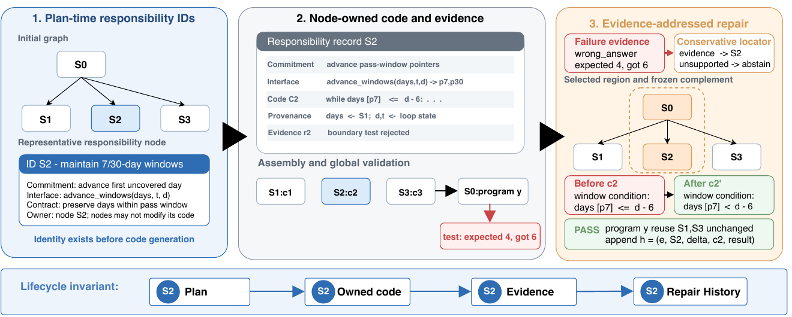

<div align="center">

# AuditCoder

### Responsibility-Preserving Task Graphs for Auditable Code Generation and Bounded Repair

Jointly generating executable programs and auditable construction records.

[Quick Start](#quick-start) ·
[Datasets](#datasets) ·
[Cross-Domain Suites](#cross-domain-suites) ·
[AgentCoder Baseline](#agentcoder-baseline) ·
[Evaluation](#evaluation) ·
[Reported Results](#reported-results) ·
[Reproducibility](#reproducibility-status)

</div>

AuditCoder is a reference implementation of a responsibility-preserving
code-generation pipeline that jointly produces executable programs and
structured construction records.

The system assigns stable responsibility IDs before code generation, binds
node-owned code and validation evidence to those IDs, and uses the same
addresses to delimit later repairs. If evidence supports a node or dependency
branch, AuditCoder regenerates only that region and reuses the frozen
complement; otherwise it abstains from claiming a bounded repair.

<p align="center">
  
</p>

<p align="center"><em>
Stable responsibility identity across planning, owned code, validation evidence,
and repair history.
</em></p>

> [!IMPORTANT]
> This repository is a development snapshot. It supports new experimental runs
> but is not, by itself, the immutable artifact used to generate every table in
> the paper.
>
> Exact table reconstruction requires the blinded Code and Data Supplement,
> which contains the fixed task IDs, model/run manifests, raw retained outputs,
> audit records, repair records, aggregate results, and checksums.

## Contents

- [Highlights](#highlights)
- [Reported Results](#reported-results)
- [Quick Start](#quick-start)
- [Installation](#installation)
- [Model Configuration](#model-configuration)
- [Datasets](#datasets)
- [Cross-Domain Suites](#cross-domain-suites)
- [AgentCoder Baseline](#agentcoder-baseline)
- [Evaluation](#evaluation)
- [Outputs and Metrics](#outputs-and-metrics)
- [Repository Layout](#repository-layout)
- [Reproducibility Status](#reproducibility-status)
- [Safety](#safety)
- [Citation](#citation)

## Highlights

- **Pre-code responsibility identities.** The planner commits a
  contract-annotated task graph before node-local implementation begins.
- **Persistent ownership and provenance.** Generated functions, validation
  reports, and assembly records remain attached to their responsibility nodes.
- **Evidence-addressed localization.** Tracebacks, resource signals, contract
  failures, and verification reports map back to a node or branch, or produce
  abstention.
- **Bounded repair with rollback records.** Repairs target an
  evidence-supported region, reuse the frozen complement, and record acceptance
  or rollback.
- **Program- and class-level evaluation.** The repository includes APPS
  experiment runners and a separate ClassEval class-generation pipeline.
- **Exploratory cross-domain evaluation.** Finance file programs, scientific
  functions, and aerospace/communications primitives use frozen external tests
  and retain the same graph-level audit evidence.

The ideal paper architecture, the reusable `auditcoder/` core, and the
experiment-specific runners under `tests/` are distinct layers. In particular,
the complete subtree-repair and audit-metric protocols live primarily in the
experiment entry points.

## Reported Results

The following numbers are transcribed from the supplied manuscript. They are
reported results, not results regenerated from this source-only checkout.

### Functional pass@1

APPS uses a fixed 200-task set: 50 introductory, 100 interview, and
50 competition problems.

| Method | DeepSeek-V3.2 | Qwen3.6-plus |
| --- | ---: | ---: |
| Direct | 68.0 | 77.5 |
| Direct + retry | 81.5 | 85.0 |
| CoT | 74.0 | 79.5 |
| CoT + retry | 90.5 | 90.0 |
| Step-by-Step | 69.0 | 75.0 |
| Framework | 67.5 | 68.5 |
| AgentCoder | **91.0** | **90.5** |
| Task plan | 39.5 | 62.5 |
| Task plan + algorithm agents | 52.0† | 70.0 |
| **AuditCoder** | **82.5** | **83.0** |

† The DeepSeek task-plan + algorithm-agents row contains 175 valid structured
outputs and is a diagnostic ablation rather than a paired 200-task comparison.

ClassEval uses all 100 class-level records in each model-method run.

| Method | DeepSeek-V3.2 | Qwen3.6-plus |
| --- | ---: | ---: |
| Direct + retry | 52.0 | 52.0 |
| CoT + retry | 55.0 | 51.0 |
| AgentCoder | **86.0** | **88.0** |
| **AuditCoder** | **75.0** | **82.0** |

### Exploratory cross-domain Resolved@1

The manuscript also reports three small frozen suites using
`deepseek-v4-flash`. AgentCoder and AuditCoder receive the same public
specification, return one final candidate, and receive no feedback from the
external tests.

| Suite | Execution unit | Tasks / frozen tests | AgentCoder | AuditCoder |
| --- | --- | ---: | ---: | ---: |
| QF-Small6 | File program | 6 / 64 | 4/6 | 4/6 |
| SciCode Blind-Small-8 | Importable function | 8 / 24 | 6/8 | 5/8 |
| AeroComm-Small8 | Importable function | 8 / 72 | 6/8 | 5/8 |

AuditCoder's reported task-macro DCTC is 89.3%, 91.2%, and 93.5%,
respectively. All 22 retained graphs pass structural integrity, and 33/35
implementation nodes pass contract-signature consistency. DCTC measures trace
completeness, not semantic correctness. With only six or eight tasks per
suite, these counts are exploratory transfer evidence rather than a reliable
cross-domain ranking.

<details>
<summary><strong>Post-hoc APPS audit summary</strong></summary>

The manuscript separately aggregates 200 completed
`deepseek-v4-flash` records. This collection is not a same-protocol rerun of
the functional table.

| Audit signal | Denominator | Reported value |
| --- | ---: | ---: |
| DCTC-leaf, task macro | 200 | 0.9625 → 0.9725 |
| Graph integrity | 200 | 185/200 (0.925) |
| Contract-signature consistency | 332 | 323/332 (0.973) |
| Recorded localization coverage | 60 failures | 26/60 (0.433) |
| Localized repair success | 26 localized | 17/26 (0.654) |
| Mean repair-region size | 26 localized | 0.468 of graph nodes |
| Mean changed-code ratio | 26 localized | 0.526 of final LOC |
| Test regression rate | 55 transactions | 2/55 (0.036) |
| Decision compliance | 55 transactions | 55/55 |
| Rollback integrity | 21 rollbacks | 21/21 |

These values describe retained process evidence and repair governance. They do
not establish semantic correctness or ground-truth localization accuracy.

</details>

## Quick Start

The shortest supported path is: install the tested dependency set, configure
one model, download ClassEval, run offline checks, and execute one class.

```bash
conda create -n auditcoder python=3.13 -y
conda activate auditcoder

python -m pip install --upgrade pip
python -m pip install --require-hashes -r requirements-lock.txt

cp .env.example .env
# Edit .env and fill QWEN_API_KEY.

mkdir -p data
curl -L --retry 3 \
  'https://raw.githubusercontent.com/FudanSELab/ClassEval/refs/heads/master/data/ClassEval_data.json' \
  -o data/ClassEval_data.json

python tests/run_apps_audit_metrics.py --self-test
python -m pytest -p no:cacheprovider tests \
  --ignore=tests/test_verifier_agent_1.py \
  -m "not integration" -q

python auditcoder_class/tests/run_classeval.py \
  --ids ClassEval_0 \
  --max-retries 0 \
  --output result/smoke_classeval
```

A successful online smoke test writes
`result/smoke_classeval/ClassEval_0.json`. Functional success is recorded in
`classeval_test_results.all_passed`.

## Installation

### Tested environment

- Local validation baseline: Python 3.13.12, macOS, CPU-only offline tests
- Checked-in CI matrix: Ubuntu 22.04/24.04 with Python 3.11/3.12/3.13
- Direct dependency pins: `requirements-tested.txt`
- Full transitive, hash-locked environment: `requirements-lock.txt`

```bash
conda create -n auditcoder python=3.13 -y
conda activate auditcoder
python -m pip install --require-hashes -r requirements-lock.txt
```

For a flexible installation using the minimum project declarations:

```bash
python -m pip install -r requirements.txt
```

Python 3.10+ is required by the source syntax. The CI floor is Python 3.11;
`requirements-tested.txt` keeps the direct pins and `requirements-lock.txt`
locks their transitive closure with distribution hashes.

Regenerate the lock only after reviewing resolver changes:

```bash
uv pip compile --universal --python-version 3.11 --generate-hashes \
  requirements-tested.txt --output-file requirements-lock.txt
```

<details>
<summary><strong>venv installation</strong></summary>

```bash
python3 -m venv .venv
source .venv/bin/activate
python -m pip install --upgrade pip
python -m pip install --require-hashes -r requirements-lock.txt
cp .env.example .env
```

</details>

## Model Configuration

Copy the template and edit the local `.env` file:

```bash
cp .env.example .env
```

```dotenv
# Generic AuditCoder pipeline: qwen or glm
AUDITCODER_LLM_PROVIDER=qwen

QWEN_API_KEY=
QWEN_BASE_URL=https://dashscope.aliyuncs.com/compatible-mode/v1/
QWEN_MODEL=qwen-plus
QWEN_MAX_TOKENS=

GLM_API_KEY=
GLM_BASE_URL=https://open.bigmodel.cn/api/paas/v4/
GLM_MODEL=glm-4.7
GLM_MAX_TOKENS=

# DeepSeek APPS baselines, subtree repair, and audit collection
DEEPSEEK_API_KEY=
DEEPSEEK_BASE_URL=https://api.deepseek.com/v1
DEEPSEEK_MODEL=deepseek-chat
DEEPSEEK_MAX_TOKENS=
```

| Runner | Provider used by current code |
| --- | --- |
| `tests/run_apps.py` | `AUDITCODER_LLM_PROVIDER=qwen` or `glm` |
| `tests/apps_qwen_*.py` | Qwen |
| `tests/apps_deepseek_*.py` | DeepSeek |
| `tests/run_apps_audit_metrics.py` | DeepSeek |
| `auditcoder_class/tests/run_classeval.py` | Qwen |
| Cross-domain AuditCoder and AgentCoder runners | DeepSeek |

Do not set the generic `AUDITCODER_LLM_PROVIDER` to `deepseek`; the generic
factory implements only Qwen and GLM. DeepSeek runners patch the model factory
inside their own process.

The template model names are runnable defaults, not the exact paper model
identifiers. Exact reproduction requires the provider-visible model name and
decoding/resource settings from the original run manifest.

## Datasets

### APPS

The [official APPS repository](https://github.com/hendrycks/apps) describes the
benchmark and original download. AuditCoder consumes the 5,000-record test
JSONL from the [Hugging Face mirror](https://huggingface.co/datasets/codeparrot/apps):

```bash
mkdir -p data
curl -L --retry 3 -C - \
  'https://huggingface.co/datasets/codeparrot/apps/resolve/main/test.jsonl?download=true' \
  -o data/apps.jsonl
```

Expected location:

```text
data/apps.jsonl
```

Each row must include `id`, `question`, `input_output`, and `difficulty`.

### ClassEval

The [official ClassEval repository](https://github.com/FudanSELab/ClassEval)
contains 100 classes and 410 methods. Download its JSON file:

```bash
mkdir -p data
curl -L --retry 3 \
  'https://raw.githubusercontent.com/FudanSELab/ClassEval/refs/heads/master/data/ClassEval_data.json' \
  -o data/ClassEval_data.json
```

Expected location:

```text
data/ClassEval_data.json
```

ClassEval code is MIT-licensed; its data is distributed under
[CC BY-NC 4.0](https://creativecommons.org/licenses/by-nc/4.0/).

### Build a paper-shaped APPS sample

This command selects a new deterministic 50/100/50 sample and records its IDs:

```bash
python sample_apps_by_difficulty.py \
  --input data/apps.jsonl \
  --output data/apps_sampled_200.jsonl \
  --ids-output data/apps_sampled_200_ids.json \
  --introductory 50 \
  --interview 100 \
  --competition 50 \
  --seed 2026 \
  --overwrite
```

This reproduces the paper's **stratum sizes**, not its exact task set. Exact
table reproduction requires the artifact's fixed ID list.

Record mutable upstream inputs before running:

```bash
shasum -a 256 data/apps.jsonl data/ClassEval_data.json \
  > data/dataset.sha256
```

<details>
<summary><strong>Dataset integrity checks</strong></summary>

APPS:

```bash
python - <<'PY'
import json
from collections import Counter
from pathlib import Path

counts = Counter()
rows = 0
with Path("data/apps.jsonl").open(encoding="utf-8") as stream:
    for rows, line in enumerate(stream, 1):
        item = json.loads(line)
        required = {"id", "question", "input_output", "difficulty"}
        assert required <= item.keys(), (rows, required - item.keys())
        counts[item["difficulty"]] += 1

assert rows == 5000, rows
print({"rows": rows, "difficulty": dict(counts)})
PY
```

ClassEval:

```bash
python - <<'PY'
import json
from pathlib import Path

items = json.loads(Path("data/ClassEval_data.json").read_text(encoding="utf-8"))
required = {"task_id", "class_name", "class_constructor", "methods_info"}
assert len(items) == 100, len(items)
assert all(required <= item.keys() for item in items)
print({"rows": len(items), "first": items[0]["task_id"]})
PY
```

</details>

## Cross-Domain Suites

Appendix K of the manuscript evaluates 22 small executable tasks outside APPS
and ClassEval. Install the additional builder and judge dependencies before
working with these suites:

```bash
python -m pip install -r requirements-cross-domain.txt
```

| Suite | Source and frozen revision | Current checkout |
| --- | --- | --- |
| QF-Small6 | [QuantitativeFinance-Bench](https://github.com/QF-Bench/QuantitativeFinance-Bench/tree/024921eb507fcc0c4ffe3e0a96802724be1ae84a), `024921eb507fcc0c4ffe3e0a96802724be1ae84a` | Runners and validators included; exact six-task package omitted |
| SciCode Blind-Small-8 | [SciCode dataset](https://huggingface.co/datasets/SciCode1/SciCode) at `4510f6a6aa27c43fad7b43da2c59602a86e88480`; [evaluator](https://github.com/scicode-bench/SciCode/tree/e3158ea011d4235245a547460d3688d7ccbf9900) at `e3158ea011d4235245a547460d3688d7ccbf9900` | Deterministic subset builder included; upstream JSONL and HDF5 targets omitted |
| AeroComm-Small8 | Authored, source-grounded suite | Self-contained builder included; generated tasks and private tests omitted |

Generated task directories, manifests, upstream hashes, HDF5 targets, reports,
and runs are excluded from version control. Build or restore them locally and
archive their hashes with each experiment.

### QF-Small6

QF-Small6 selects six file-oriented finance tasks:

```text
earnings-surprise-calculator
corporate-action-adjustment
historical-var-data-prep
interest-rate-cap-floor
zero-coupon-bootstrapping
pca-factor-portfolio
```

The paper's evaluator combines 48 upstream tests with 16 additional contract
tests, for 64 frozen tests. Clone the pinned upstream repository for source
provenance:

```bash
mkdir -p data/upstream
git clone \
  https://github.com/QF-Bench/QuantitativeFinance-Bench.git \
  data/upstream/QuantitativeFinance-Bench
git -C data/upstream/QuantitativeFinance-Bench \
  checkout 024921eb507fcc0c4ffe3e0a96802724be1ae84a
```

Cloning upstream is **not sufficient** to reconstruct the paper package. This
checkout does not include the subset packager, four public clarifications, 16
additional contract tests, private oracles, `dataset_manifest.json`, or
`UPSTREAM_SHA256SUMS`. Restore the exact QF-Small6 artifact under
`experiments/cross_domain_real_world_20260726/qf_small6_dataset/` before
running:

```bash
QF_ROOT=experiments/cross_domain_real_world_20260726/qf_small6_dataset

python "$QF_ROOT/tools/validate_dataset.py"

python "$QF_ROOT/tools/run_portable_oracle.py" \
  --python "$(command -v python)" \
  --mode oracle \
  --report reports/oracle_validation.json

python "$QF_ROOT/tools/run_portable_oracle.py" \
  --python "$(command -v python)" \
  --mode negative-control \
  --report reports/negative_control.json

python "$QF_ROOT/tools/run_auditcoder_qf_small6.py" \
  --run-id qf-small6-auditcoder

# One-task AgentCoder smoke run
python "$QF_ROOT/tools/run_agentcoder_qf_small6.py" \
  --run-id qf-small6-agentcoder-smoke \
  --task earnings-surprise-calculator

# Full six-task AgentCoder run
python "$QF_ROOT/tools/run_agentcoder_qf_small6.py" \
  --run-id qf-small6-agentcoder
```

The portable judge rewrites host paths and records
`official_harbor_docker: false`. It is useful for local checking, but it is not
the upstream QF-Bench Harbor/Docker execution protocol. Use the pinned
upstream environment when claiming official QF-Bench reproduction.

### SciCode Blind-Small-8

This suite freezes the first independent substeps `13.1`, `14.1`, `25.1`,
`28.1`, `35.1`, `37.1`, `45.1`, and `77.1`. Each task exposes one function and
uses three official numerical cases; reference implementations and HDF5
targets remain hidden from generation.

Download the pinned public problem records and evaluator:

```bash
mkdir -p data/upstream/scicode-hf data/upstream

curl -L --retry 3 \
  'https://huggingface.co/datasets/SciCode1/SciCode/resolve/4510f6a6aa27c43fad7b43da2c59602a86e88480/problems_test.jsonl?download=true' \
  -o data/upstream/scicode-hf/problems_test.jsonl

git clone \
  https://github.com/scicode-bench/SciCode.git \
  data/upstream/SciCode
git -C data/upstream/SciCode \
  checkout e3158ea011d4235245a547460d3688d7ccbf9900
```

Download the official numeric `test_data.h5` from the
[SciCode test-data folder](https://drive.google.com/drive/folders/1W5GZW6_bdiDAiipuFMqdUhvUaHIj6-pR?usp=drive_link)
referenced by the upstream README. Keep this file evaluator-only; do not expose
it to the generation process. Then build and validate the frozen subset:

```bash
SCICODE_ROOT=experiments/cross_domain_real_world_20260726/scicode_blind8_dataset

python "$SCICODE_ROOT/tools/build_dataset.py" \
  --problems-test data/upstream/scicode-hf/problems_test.jsonl \
  --test-data data/upstream/scicode-hf/test_data.h5 \
  --upstream-repo data/upstream/SciCode

python "$SCICODE_ROOT/tools/validate_dataset.py"
python "$SCICODE_ROOT/tools/run_evaluator_smoke.py"

python "$SCICODE_ROOT/tools/run_auditcoder_scicode_blind8.py" \
  --run-id scicode-blind8-auditcoder

# One-task AgentCoder smoke run
python "$SCICODE_ROOT/tools/run_agentcoder_scicode_blind8.py" \
  --run-id scicode-blind8-agentcoder-smoke \
  --task 13.1

# Full eight-task AgentCoder run
python "$SCICODE_ROOT/tools/run_agentcoder_scicode_blind8.py" \
  --run-id scicode-blind8-agentcoder
```

The builder copies only the eight selected HDF5 groups into
`private/targets.h5`, writes public/private task records, saves upstream hashes,
and records both frozen revisions in `dataset_manifest.json`.

### AeroComm-Small8

AeroComm-Small8 contains four aerospace tasks (vis-viva speed, Hohmann
transfer, elliptic Kepler equation, and quaternion rotation) and four
communications tasks (Gray QPSK, free-space path loss, CRC-16, and a rate-1/2
convolutional encoder). It is an authored, source-grounded suite—not an
official NASA, JPL, ITU, or CCSDS benchmark and not safety-critical flight
software.

The included builder regenerates all public prompts, 72 private cases, oracle
implementations, the source registry, and the manifest:

```bash
AEROCOMM_ROOT=experiments/cross_domain_real_world_20260726/aerocomm_small8_dataset

python "$AEROCOMM_ROOT/private/build_dataset.py"
python "$AEROCOMM_ROOT/tools/validate_dataset.py"
python "$AEROCOMM_ROOT/tools/run_oracle.py"
python "$AEROCOMM_ROOT/tools/run_negative_control.py"

python "$AEROCOMM_ROOT/tools/run_auditcoder_aerocomm.py" \
  --run-id aerocomm-small8-auditcoder

# One-task AgentCoder smoke run
python "$AEROCOMM_ROOT/tools/run_agentcoder_aerocomm.py" \
  --run-id aerocomm-small8-agentcoder-smoke \
  --task AC-AERO-01

# Full eight-task AgentCoder run
python "$AEROCOMM_ROOT/tools/run_agentcoder_aerocomm.py" \
  --run-id aerocomm-small8-agentcoder
```

The expected dataset checks are 8/8 oracle tasks and 72/72 tests passing, while
the deterministic `return None` negative control resolves 0/8 tasks.

### Shared cross-domain protocol

All six AuditCoder/AgentCoder cross-domain runners read the `DEEPSEEK_*`
variables in `.env`.
`--task` may be repeated to run a subset; the default is the complete suite.
Use `--force` only when intentionally replacing an existing per-task result.
The functional verdict is the frozen external judge's `task_resolved`, not the
pipeline's internal verifier status.

SciCode and AeroComm use the active Python interpreter for their frozen judge.
If the judge dependencies live in a separate environment, set
`SCICODE_EVAL_PYTHON=/absolute/path/to/python` or
`AEROCOMM_EVAL_PYTHON=/absolute/path/to/python` explicitly; the selected path
is recorded in the run configuration.

For manuscript-comparable runs, keep one final candidate per task, reveal no
frozen-test feedback to the generator, and report resolved-task counts
separately for each suite. Do not pool test cases across suites because their
test granularity differs.

## AgentCoder Baseline

The repository now includes both parts needed to audit the paper's
cross-domain AgentCoder comparison:

- a code-only snapshot of the
  [official AgentCoder implementation](https://github.com/huangd1999/AgentCoder)
  at commit `d8538d63675c2b805855e6deb7ddc39fefb5723d` under
  `baselines/agentcoder/upstream/`;
- the three executable interface adapters listed in
  `experiments/cross_domain_real_world_20260726/README.md`.

The snapshot excludes upstream benchmark data, generated results, images, and
the CodeGeeX submodule. The adapters do not execute the legacy OpenAI 0.28
scripts; they preserve the programmer/test-designer/test-executor protocol
using this repository's current OpenAI-compatible client.

The reported cross-domain AgentCoder results use a protocol-preserving adapter,
not the original HumanEval/MBPP runner. The pinned upstream README identifies
AgentCoder as MIT-licensed. Vendored third-party files remain governed by their
upstream license and attribution; see `THIRD_PARTY_NOTICES.md` and
`baselines/agentcoder/LICENSE-UPSTREAM`.

Each AgentCoder run writes:

```text
<suite>/runs/<run-id>/
├── run_config.json            # model, source, dataset, and protocol snapshot
├── llm_calls.json             # raw call metadata and token usage
├── summary.json               # task- and test-level aggregate
├── SUMMARY.md                 # human-readable report
├── ARTIFACT_SHA256SUMS        # retained run hashes
└── tasks/<task-id>/
    ├── final_code.py
    ├── result.json
    └── pools/                 # generated candidates and tester evidence
```

Frozen tests are used only after AgentCoder selects its final candidate.
Generated tester scores are selection evidence, not the functional verdict.

### Re-test retained AgentCoder data

QF-Small6 reuses its runner's evaluate-only mode:

```bash
QF_ROOT=experiments/cross_domain_real_world_20260726/qf_small6_dataset
python "$QF_ROOT/tools/run_agentcoder_qf_small6.py" \
  --run-id qf-small6-agentcoder \
  --evaluate-only
```

Keep each task's `prompt.txt` beside `final_code.py`. QF candidates may contain
the absolute application path used during generation; evaluate-only recovers
that recorded path from the prompt, creates an evaluation-only relocated copy,
and leaves `final_code.py` unchanged. Inspect
`external_evaluation.candidate_path_relocation` in each `result.json` to audit
the original/evaluated hashes and replacement count.

SciCode and AeroComm expose dedicated deterministic re-verifiers:

```bash
SCICODE_ROOT=experiments/cross_domain_real_world_20260726/scicode_blind8_dataset
python "$SCICODE_ROOT/tools/reverify_run.py" \
  --run "$SCICODE_ROOT/runs/scicode-blind8-agentcoder" \
  --output "$SCICODE_ROOT/reports/scicode-agentcoder-reverify.json"

AEROCOMM_ROOT=experiments/cross_domain_real_world_20260726/aerocomm_small8_dataset
python "$AEROCOMM_ROOT/tools/reverify_run.py" \
  --run "$AEROCOMM_ROOT/runs/aerocomm-small8-agentcoder" \
  --output "$AEROCOMM_ROOT/reports/aerocomm-agentcoder-reverify.json"
```

For every suite, require:

1. the re-verifier exit code to be zero;
2. every retained candidate hash to match the recorded candidate;
3. stored and current frozen-test verdicts to match;
4. `pipeline_errors == 0`;
5. `resolved_tasks` to be computed over the requested task denominator;
6. `method == "AgentCoder"` and the expected dataset revision in
   `summary.json`.

Historical AgentCoder run directories are not included in this code-only
checkout. These commands validate newly generated or separately restored run
data; they do not recreate the manuscript counts without the original bundle.

## Evaluation

### 1. Offline verification

These checks do not call a model:

```bash
python -m compileall -q \
  auditcoder auditcoder_class baselines/agentcoder tests experiments \
  scripts sample_apps_by_difficulty.py

python scripts/validate_artifact_manifest.py --self-test

python tests/run_apps_audit_metrics.py --self-test

python scripts/check_no_secrets.py

python -m pytest -p no:cacheprovider tests \
  --ignore=tests/test_verifier_agent_1.py \
  -m "not integration" \
  -q
```

`tests/test_verifier_agent_1.py` is a live API demonstration and is excluded
from the offline suite.

### 2. APPS smoke tests

Generic pipeline:

```bash
python tests/run_apps.py \
  --data data/apps.jsonl \
  --ids 0 \
  --max-cases 3 \
  --output result/smoke_apps
```

Qwen bounded-subtree runner:

```bash
python tests/apps_qwen_subtree_retry.py \
  --data data/apps.jsonl \
  --ids 0 \
  --max-cases 3 \
  --output result/smoke_apps_qwen
```

DeepSeek bounded-subtree runner:

```bash
python tests/apps_deepseek_subtree_retry.py \
  --data data/apps.jsonl \
  --ids 0 \
  --max-cases 3 \
  --output result/smoke_apps_deepseek
```

### 3. Full APPS runs

```bash
# Qwen
python tests/apps_qwen_subtree_retry.py \
  --data data/apps_sampled_200.jsonl \
  --offset 0 \
  --count 200 \
  --max-cases 10 \
  --output result/apps_auditcoder_qwen

# DeepSeek
python tests/apps_deepseek_subtree_retry.py \
  --data data/apps_sampled_200.jsonl \
  --offset 0 \
  --count 200 \
  --max-cases 10 \
  --output result/apps_auditcoder_deepseek
```

`--max-cases 10` is a practical example for controlling local cost. It must not
be described as the paper setting unless the original manifest confirms it.

### 4. Collect APPS audit records

```bash
python tests/run_apps_audit_metrics.py \
  --data data/apps_sampled_200.jsonl \
  --offset 0 \
  --count 200 \
  --max-cases 10 \
  --output result/apps_audit_metrics
```

The runner writes one `apps_<id>.json` per problem and an aggregated
`summary_audit_metrics.json`. It records initial/final states, task graphs,
owned snippets, execution evidence, localization, repair scope, acceptance or
rollback data, audit metrics, and token usage.

This creates a **new** audit collection. It does not reconstruct the manuscript's
post-hoc 200-record collection without the original records and source
manifest.

### 5. ClassEval

```bash
# One-task smoke test
python auditcoder_class/tests/run_classeval.py \
  --ids ClassEval_0 \
  --max-retries 0 \
  --output result/smoke_classeval

# Full 100-task run
python auditcoder_class/tests/run_classeval.py \
  --start 0 \
  --count 100 \
  --max-retries 2 \
  --output result/classeval_auditcoder_qwen
```

<details>
<summary><strong>Baselines and ablations</strong></summary>

APPS:

| Method family | Qwen | DeepSeek |
| --- | --- | --- |
| Direct + retry | `tests/apps_qwen_retry.py` | `tests/apps_deepseek_retry.py` |
| CoT | `tests/apps_qwen_cot.py` | `tests/apps_deepseek_cot.py` |
| Step-by-step | `tests/apps_qwen_stepbystep.py` | `tests/apps_deepseek_stepbystep.py` |
| Framework | `tests/apps_qwen_framework.py` | `tests/apps_deepseek_framework.py` |
| Task plan | `tests/apps_qwen_taskplan.py` | `tests/apps_deepseek_taskplan.py` |
| Task plan + algorithm agents | `tests/apps_qwen_taskplan_algo.py` | `tests/apps_deepseek_taskplan_algo.py` |
| Error-subtree repair | `tests/apps_qwen_subtree_retry.py` | `tests/apps_deepseek_subtree_retry.py` |

Additional repair-scope ablations:

- `tests/run_apps_no_fv.py`
- `tests/run_apps_path_replan.py`
- `tests/run_apps_fullpath_replan.py`
- `tests/run_apps_global_replan.py`

ClassEval:

```bash
# CoT + retry
python auditcoder_class/tests/run_classeval_cot.py \
  --start 0 --count 100 --max-retries 2 \
  --output result/classeval_cot_qwen

# Direct + retry; historical filename, current implementation uses Qwen
python auditcoder_class/tests/run_classeval_deepseek_retry.py \
  --start 0 --count 100 --max-retries 2 \
  --output result/classeval_direct_retry_qwen
```

The current source package does not contain a manuscript-bound DeepSeek
ClassEval AuditCoder entry point.

</details>

## Outputs and Metrics

### Functional verdicts

| Benchmark | Per-task verdict |
| --- | --- |
| APPS | `apps_test_results.all_passed` |
| ClassEval | `classeval_test_results.all_passed` |
| QF-Small6 | `external_evaluation.task_resolved` |
| SciCode Blind-Small-8 | `external_evaluation.task_resolved` |
| AeroComm-Small8 | `external_evaluation.task_resolved` |

The final “pipeline completed without exception” count printed by
`tests/run_apps.py` is an engineering completion count, not functional
correctness. Always compute pass@1 from the stored test verdict.

Example APPS summary:

```bash
python - <<'PY'
import json
from pathlib import Path

root = Path("result/apps_auditcoder_qwen")
records = [json.loads(p.read_text(encoding="utf-8"))
           for p in root.glob("apps_*.json")]
passed = sum(bool((r.get("apps_test_results") or {}).get("all_passed"))
             for r in records)
print({
    "records": len(records),
    "passed": passed,
    "failed_or_error": len(records) - passed,
    "pass_at_1": passed / len(records) if records else None,
})
PY
```

Pipeline errors remain in the denominator as failures. Report expected tasks,
written records, malformed records, and missing records before reporting
pass@1.

### Audit metrics

`tests/run_apps_audit_metrics.py` exposes deterministic formula tests and
task-level aggregation for DCTC, localization coverage, localized repair
success, repair-region size, changed-code ratio, regression, decision
compliance, rollback integrity, and token usage.

Audit metrics measure record structure and intervention behavior. They must be
reported separately from functional correctness.

## Repository Layout

```text
AuditCoder/
├── .github/workflows/           # Linux/Python offline CI matrix
├── assets/                     # README/paper overview assets
├── baselines/
│   └── agentcoder/             # upstream source snapshot and protocol notes
├── containers/eval/            # pinned non-root Python evaluation image
├── auditcoder/
│   ├── plan_agent/             # contracts, decomposition, task graph
│   ├── algo_agents/            # node-local algorithm generators
│   ├── verifier_agent/         # node-local validation
│   ├── assembler_agent/        # dependency-aware composition
│   ├── final_verifier_agent/   # global evidence, localization, repair
│   └── schemas/                # task-plan and verification schemas
├── auditcoder_class/           # ClassEval class-level pipeline
├── scripts/                    # artifact validation and secret checks
├── tests/                      # APPS runners, baselines, ablations, tests
├── experiments/                # cross-domain builders, judges, and runners
├── THIRD_PARTY_NOTICES.md
├── sample_apps_by_difficulty.py
├── requirements.txt            # flexible direct dependencies
├── requirements-tested.txt     # locally verified direct versions
├── requirements-lock.txt       # transitive versions and distribution hashes
├── requirements-cross-domain.txt
│                               # extra scientific/data dependencies
└── .env.example
```

For a module-level walkthrough, see [`ARCHITECTURE.md`](ARCHITECTURE.md).

## Reproducibility Status

| Artifact | Current repository |
| --- | --- |
| Core generation and verification code | Included |
| Docker/Podman generated-code backend and pinned image recipe | Included |
| Ubuntu/Python offline CI configuration | Included |
| Transitive dependency lock with hashes | Included |
| Artifact-manifest validator | Included |
| APPS and ClassEval runners | Included |
| AgentCoder code-only upstream snapshot | Included |
| Cross-domain AuditCoder/AgentCoder adapters | Included |
| Public dataset download commands | Included in this README |
| Deterministic APPS sampling utility | Included |
| Fixed APPS paper task IDs | **Not included** |
| Exact model/decoding/resource manifests | **Not included** |
| Raw functional-run outputs | **Not included** |
| Raw 200-record post-hoc audit collection | **Not included** |
| QF-Small6 exact package and result records | **Not included** |
| SciCode subset builder | Included |
| SciCode upstream JSONL/HDF5 and results | **Not included** |
| AeroComm task/test/oracle builder | Included |
| AeroComm generated artifacts and results | **Not included** |
| Historical AgentCoder run data | **Not included** |
| Manuscript-bound DeepSeek ClassEval runner | **Not included** |

For a defensible experiment, archive:

1. source commit or source-tree hash;
2. dataset URL, upstream revision, file hash, and fixed task IDs;
3. provider-visible model name and decoding/call budget;
4. Python and dependency versions;
5. timeout, memory policy, test-case limit, and hardware/OS;
6. raw responses, final retained candidate, stdout/stderr, and test evidence;
7. task graph, ownership map, localization evidence, repair boundary, and
   acceptance/rollback record;
8. expected denominator, malformed/missing records, and aggregation output.

Validate a restored Code and Data Supplement before aggregating it:

```bash
python scripts/validate_artifact_manifest.py \
  /path/to/supplement/artifact_manifest.json
```

The AeroComm suite can be regenerated from its included source-grounded
builder. SciCode can be rebuilt after downloading its pinned public JSONL and
official private HDF5 targets. QF-Small6 cannot be reconstructed exactly from
this checkout because its artifact-specific packaging and added contract cases
are absent.

## Safety

The historical/default `host` backend executes generated programs in a host
Python subprocess. It is not a security sandbox: it does not isolate the
filesystem, network, environment variables, or system calls, and macOS skips
the memory `RLIMIT`.

For untrusted generated code, build and select the container backend:

```bash
docker build --tag auditcoder-eval:aaai27 containers/eval

export AUDITCODER_EXECUTION_BACKEND=container
export AUDITCODER_CONTAINER_RUNTIME=docker
export AUDITCODER_CONTAINER_IMAGE=auditcoder-eval:aaai27
```

The executor applies `--network=none`, a read-only root filesystem, a non-root
UID, dropped capabilities, `no-new-privileges`, CPU/memory/PID limits, and a
bounded `noexec` temporary filesystem. It mounts generated code read-only and
does not forward host API keys. A file-I/O execution contract mounts only its
explicit `app_dir` writable. See `containers/eval/README.md` for the exact
boundary.

If Docker/Podman is unavailable, use a disposable low-privilege account with no
production credentials or sensitive files; do not mistake the host backend's
timeout/resource checks for isolation.

## Citation

Add the final author list, venue, paper URL, and BibTeX entry when the public
paper version is available.

Datasets:

```bibtex
@article{hendrycksapps2021,
  title   = {Measuring Coding Challenge Competence With APPS},
  author  = {Dan Hendrycks and Steven Basart and Saurav Kadavath and others},
  journal = {NeurIPS},
  year    = {2021}
}

@misc{du2023classeval,
  title         = {ClassEval: A Manually-Crafted Benchmark for Evaluating LLMs
                   on Class-level Code Generation},
  author        = {Xueying Du and Mingwei Liu and Kaixin Wang and others},
  year          = {2023},
  eprint        = {2308.01861},
  archivePrefix = {arXiv},
  primaryClass  = {cs.CL}
}

@misc{qfbench2026,
  author       = {{QF-Bench}},
  title        = {QuantitativeFinance-Bench: A State-Aware Interactive
                  Benchmark for Financial Agent Tasks},
  year         = {2026},
  howpublished = {\url{https://github.com/QF-Bench/QuantitativeFinance-Bench}}
}

@inproceedings{tian2024scicode,
  title     = {SciCode: A Research Coding Benchmark Curated by Scientists},
  author    = {Tian, M. and others},
  booktitle = {Advances in Neural Information Processing Systems},
  volume    = {37},
  pages     = {30624--30650},
  year      = {2024}
}
```

## License

AuditCoder is released under the [MIT License](LICENSE).

Third-party code, benchmark data, model outputs, and generated datasets remain
governed by their respective upstream licenses and terms. In particular,
ClassEval data and QF-Bench-derived data are non-commercial datasets; the MIT
license applies to AuditCoder's source code, not to those external datasets.
See `THIRD_PARTY_NOTICES.md` for vendored-code attribution.

Confirm the venue's artifact and anonymity policy before publishing a
manuscript-linked repository or supplement.
